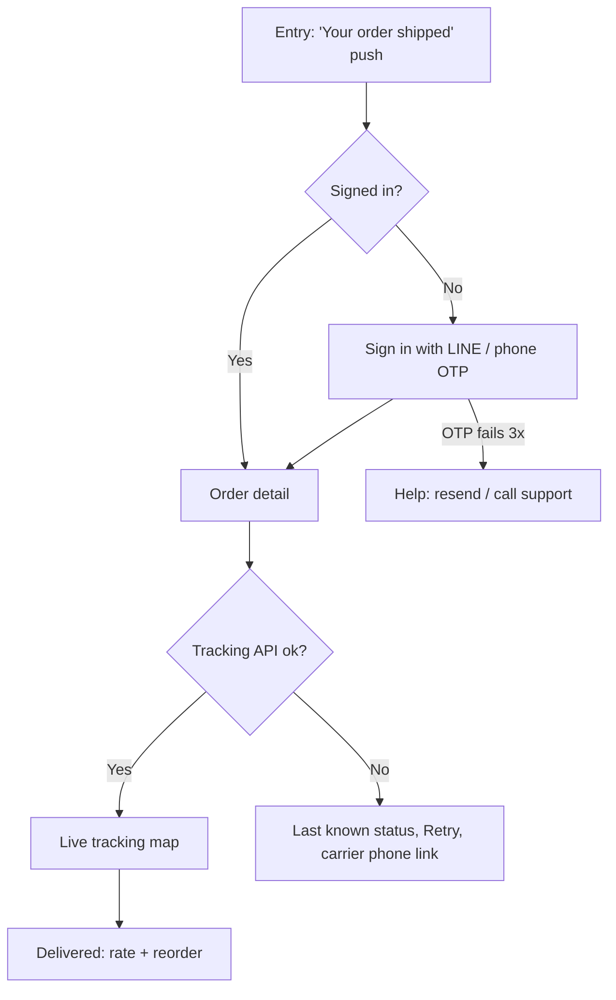

# UX foundations: what good UX is and how to check it

> Read when: defining what "good" means for a screen or flow, running a heuristic review of your own or someone else's design, writing UI copy, error or empty states, designing forms, onboarding or navigation, drawing user/task flows or wireflows, choosing UX metrics (HEART, SUS, SEQ, UMUX-Lite, task success), or before handing off any design (run the quality bar in section 12).

**Contents:** 1 Definition · 2 Norman's principles · 3 Nielsen's heuristics as tests · 4 Krug · 5 IA & navigation · 6 Content design · 7 Screen states · 8 Forms · 9 Onboarding · 10 Flows · 11 UX metrics · 12 UX quality bar · Pitfalls · Sources

Related: research before designing → `user-research.md`; cognitive biases and laws → `psychology.md`; WCAG → `accessibility.md`; platform conventions → `platform-web.md`, `platform-mobile.md`, `platform-desktop.md`; recurring screens (checkout, dashboards, settings) → `product-patterns.md`. Templates: `../templates/design-brief.md`, `../templates/persona-jtbd.md`, `../templates/usability-test-script.md`.

## 1. Definition of good UX

**Usability (ISO 9241-11:2018, clause 3.1.1):** the extent to which a system, product or service can be used by *specified users* to achieve *specified goals* with **effectiveness, efficiency and satisfaction** in a *specified context of use*. Good UX is therefore never absolute: always name who, which goal and which context before judging.

| ISO component | Plain meaning | How to measure it | Typical target |
|---|---|---|---|
| Effectiveness | Did they achieve the goal, completely and accurately? | Task success rate, error rate | Median across studies is 78%; >92% is top quartile (MeasuringU). High-cost tasks (payment, medication) need ≈100% |
| Efficiency | Effort spent for that result | Time on task (geometric mean), steps, clicks, error recoveries | Beat the current solution or best competitor on the same task |
| Satisfaction | How it felt | SEQ per task, SUS or UMUX-Lite per product | SEQ ≥ 5.5/7 (about average); SUS ≥ 68 (average), ≥ 80.3 (A) |
| Context of use | Users, tasks, equipment, physical + social environment | Write it down in the brief | One-handed on a bus vs. desk with two monitors are different products |

**Priority rule: useful > usable > delightful.** Check in that order and stop at the first failure.
1. *Useful*: it does a job the user actually has (see JTBD in `user-research.md`). Norman & Nielsen's example: a flawless film search over a catalogue missing the films people want is still a bad experience.
2. *Usable*: the target user completes the job without help (heuristics, testing). Morville: "usability is necessary but not sufficient".
3. *Delightful*: aesthetics, motion, personality (see `motion.md`, `styles-catalog.md`). Delight never compensates for 1 or 2.

**Morville's UX honeycomb (2004)** as a review lens; pick the 2–3 facets that matter most for this product and say so explicitly.

| Facet | Check question |
|---|---|
| Useful | Which job does this screen serve? If none, cut it. |
| Usable | Can a first-time user finish the core task unaided? |
| Desirable | Does the visual identity fit audience and brand (brief Q10)? |
| Findable | Can users locate content and features from where they land (tree test, search)? |
| Accessible | Does it meet WCAG 2.2 AA (`accessibility.md`)? |
| Credible | Are prices, fees, identity, security and contact visible before commitment? |
| Valuable | Which business metric does it move (brief Q11)? |

**UX vs UI.** UX = the whole experience with the company, service and product (Norman & Nielsen), including content, pricing, delivery, support. UI = the screens and controls. Usability is a quality of the UI. A UI can be polished while the UX fails (wrong catalogue, hidden fees, slow delivery). When asked for "UI", still check UX at the boundaries: entry point, what happens after the last screen, failure paths.

**Human-centred design (ISO 9241-210:2019), six principles to apply:** design from an explicit understanding of users, tasks and environments; involve users throughout; drive and refine with user-centred evaluation; iterate; address the whole user experience; use a multidisciplinary team.

## 2. Norman's principles (The Design of Everyday Things)

| Principle | Meaning | Check on your design | Failure example |
|---|---|---|---|
| Affordance | What actions are possible, as a relationship between thing and person | Is the action physically possible for this user (target size, reach, AT)? | Swipe-only delete; nothing for keyboard or switch users |
| Signifier | Perceivable cue showing where and how to act | Can you tell what is clickable in a greyscale screenshot? | Flat text that is secretly a button; icon-only controls without labels |
| Mapping | Layout of controls matches layout of effects | Is each control next to what it changes; does direction match (up = more)? | Filter panel far from results; slider moving opposite to value |
| Feedback | Immediate, informative result of every action | Does every tap produce visible change within 0.1 s, and progress beyond 1 s? | "Save" with no confirmation; silent failure |
| Constraint | Limit possible actions to valid ones | Are invalid choices unavailable or prevented (date pickers, disabled past dates)? | Free-text date field that accepts "31/02" |
| Conceptual model | The system explains how it works | Can a user predict the result of an action before taking it? | Sync vs. backup confusion; "archive" that deletes |

**Gulf of execution** (plan + manipulate): the user knows what to do and how. Bridge it with familiar patterns and controls that behave as they look. Action labels say what *will* happen.
**Gulf of evaluation** (perceive + interpret): the user can tell what happened and what state the system is in. Bridge it with labels that state the current state, positive wording ("Notifications: On", never "Hide notifications: Off"), checkboxes rather than ambiguous toggles for settings, and visible results.
Diagnose a failure by subtask: did they not see it, misread it, plan wrong, or mis-operate the control?

**Mental models.** Users expect your product to work like the ones they already use. One search box that searches everything; Back returns to the previous screen; the cart only holds what they put in. Innovate on a convention only when the new way is clearly better, and teach it in context. When users' model and the system's model disagree, change the system (card sort, rename) before trying to change the user (explanations).

## 3. Nielsen's 10 heuristics as pass/fail tests

Run each test per screen *and* per flow. Log violations with a severity (below).

| # | Heuristic | Pass test (all must be yes) | Common fail |
|---|---|---|---|
| 1 | Visibility of system status | Every action gets feedback ≤ 0.1 s; waits > 1 s show progress; current location, selection, save/sync state are visible | Button with no pressed/loading state; unsaved changes not indicated |
| 2 | Match with the real world | All labels use the user's vocabulary (verified from research, reviews or search logs); order follows the real-world task | Internal jargon ("SKU", "entity", "workspace object"); dates in system format |
| 3 | User control and freedom | Every screen has an obvious exit; destructive actions are undoable or confirmed; multi-step flows allow Back without data loss | Modal with no close; wizard that wipes input on Back |
| 4 | Consistency and standards | Same word, icon and position for the same action everywhere; platform conventions followed | "Remove" here, "Delete" there; custom date picker on iOS |
| 5 | Error prevention | High-cost errors are prevented by constraints, smart defaults or confirmation; formats are explained before input | Free-text field for a fixed set; irreversible send without review |
| 6 | Recognition over recall | Options, recent items, entered values and instructions stay visible where needed | Code shown on step 1 and needed on step 3; hidden filters |
| 7 | Flexibility and efficiency | Frequent users get accelerators (shortcuts, recent, bulk actions, saved defaults) that novices can ignore | Power users forced through the same 6-step wizard daily |
| 8 | Aesthetic and minimalist design | Each element supports the primary task; secondary info is progressively disclosed | Three equal-weight CTAs; promotional banners inside task flows |
| 9 | Recognize, diagnose, recover from errors | Errors in plain language, next to the cause, say what went wrong and how to fix it; input preserved | "Error 422"; "Invalid input"; form cleared after failed submit |
| 10 | Help and documentation | Help is contextual, searchable, task-oriented and short | Help only as a PDF manual; tooltip hiding required info |

**Running a heuristic evaluation:** 3–5 evaluators work independently, 1–2 h, scoped to one flow or user group. Pass 1 learns the flow; pass 2 records violations with heuristic number, location, severity and fix. Consolidate with affinity grouping. A violation is not automatically a problem: judge it in context, then validate with users. It never replaces testing (`../templates/usability-test-script.md`).

**Severity scale (Nielsen):** 0 not a problem · 1 cosmetic, fix if time · 2 minor, low priority · 3 major, high priority · 4 catastrophe, fix before release. Rate on frequency × impact × persistence, then adjust for market impact.

## 4. Krug's rules (Don't Make Me Think, Revisited, 2014)

- **First law:** every page should be self-evident. If a first-time user has to stop and think "where do I click?", fix it.
- **Clicks:** the number of clicks matters less than whether each one is a mindless, unambiguous choice. Don't merge steps if that makes a choice ambiguous.
- **Users scan, satisfice and muddle through:** they pick the first reasonable option. Design for scanning: a clear visual hierarchy, conventions, clearly defined areas, obvious clickables, little noise.
- **Omit needless words:** cut the words on each page by half, then cut half of what is left. Delete "happy talk" intros and instructions nobody reads.
- **Trunk test** (paraphrased): open any inner page with the browser chrome hidden. Within seconds a user should be able to say what site this is, which page they are on, what the major sections are, what options exist here, and where they are in the hierarchy. Search should be findable too. If not, fix the page title, the navigation highlight and the breadcrumbs.
- **Test early, cheaply, often:** a few users each month beat one big test at the end.

## 5. Information architecture and navigation

IA is the structure and naming of content and functions. Navigation is the visible UI on top of it. **Define IA before choosing a navigation pattern.**

Recipe:
1. Inventory every content type and feature (spreadsheet: item, owner, frequency of use, audience).
2. Group and label using user vocabulary. Run an open card sort (≥ 15 participants, 30–50 cards) when the domain is unfamiliar to the team; see `user-research.md` §9.
3. Draft the tree. Prefer broad and shallow over narrow and deep. Every label should predict what is underneath it ("information scent").
4. Tree-test the top tasks before visual design. As a rule of thumb, rework any task below the common 70% success target or with low directness.
5. Pick patterns by priority of use: primary destinations always visible; secondary behind one disclosure; **two levels of progressive disclosure is the practical maximum**.

Navigation checks:
- The current location is always marked (selected tab, highlighted nav item, page title matches the link clicked).
- One global search with a predictable scope. If search is scoped, say so in the placeholder or label ("Search orders").
- Back (browser, OS gesture, app bar) returns to the previous screen and preserves scroll, filters and form input.
- Deep links open the right screen, with a path back to home.
- Labels are nouns for places and verbs for actions. No "Misc", "Other", "More" when you can name the content.
- Icon-only navigation needs text labels unless the icons are universally standard.

## 6. Content design and UX writing

**Voice vs tone.** Voice is the stable personality (2–4 adjectives in the brief). Tone shifts with the user's emotional state: neutral and precise for errors and money, warmer for success and empty states. Clarity always beats wit. No humour in errors, because it wears thin on repeat.

**Readability defaults (GOV.UK practice):** split sentences over 25 words; paragraphs ≤ 5 sentences; front-load the key word in headings, links and buttons; active voice; plain words over jargon. Assume the user is reading on a phone, distracted, in a second language.

**Buttons and CTAs**
- Verb + object, 2–4 words, describing the result: "Pay ฿1,250", "Send invoice", "Continue to billing". Avoid "Submit", "OK", "Yes", "Click here".
- Confirmations name the action on both buttons: "Discard draft" / "Keep editing", never "OK / Cancel".
- One primary CTA per view. Secondary actions are visually quieter. Destructive actions are never the default.
- Same command = same label everywhere. Add a noun when the verb alone is ambiguous ("Delete folder").
- An ellipsis ("Export…") means more input is needed before the action runs.

**Error message formula:** *what happened* + *how to fix it* (+ *why*, only if it helps). Place it next to the cause, make it visible without relying on colour, keep the user's input, and don't blame.

| Avoid | Write instead |
|---|---|
| "Invalid input" | "Enter a date in the past, like 14/02/1990" |
| "Error 500" | "We couldn't save your changes. Check your connection and try again. Your edits are kept." |
| "Password incorrect format" | "Use at least 8 characters, including a number" (shown before typing) |
| "Something went wrong" | "Payment didn't go through. Your card wasn't charged. Try another card or PromptPay." |
| "Are you sure?" | "Delete 3 photos? You can restore them from Trash for 30 days." |

**Empty-state formula:** what this area is for + why it is empty + one action to fill it (+ optional sample data). "No invoices yet. Invoices you send appear here. [Create invoice]". Never show "No results" while data is still loading.

**Microcopy checks:** labels are visible (not placeholders); hints are above the field; units and formats are stated ("kg", "DD/MM/YYYY"); numbers, prices and dates use the user's locale; the same term is used for the same concept across product, emails and support.

**Thai copy (ไทย).** Thai has no spaces between words, so long labels wrap unpredictably and truncation can cut mid-word. Keep labels short in both languages and test both. Decide in the brief whether UI copy uses polite particles (ค่ะ/ครับ). They are gendered, so pick one policy (none, or one persona voice) and apply it everywhere. For line height and fonts see `typography-layout.md`.

## 7. Screen states: design every one

Design the **ideal** state first, then every other state before handoff (Scott Hurff's UI stack, plus offline and permission states). A screen spec without these is incomplete.

| State | When | Must show | Check |
|---|---|---|---|
| Ideal | Typical full data | Primary task and next action | The CTA is obvious within 5 s (5-second test) |
| Empty: first use | No data yet | Purpose, how to start, one CTA, optionally sample data | No dead end; teaches the feature |
| Empty: user-cleared | User finished or deleted everything | Positive confirmation + next step | "Inbox zero" is not treated as an error |
| Empty: no results | Search or filter returned nothing | The query as typed, suggestions, a way to clear filters | Offers spelling fixes or nearby results |
| Loading < 1 s | Fast fetch | Nothing extra; avoid a spinner flash | No layout shift when data lands |
| Loading 1–10 s | Typical network | Skeleton for full page, spinner for a single module; button shows a busy state and is disabled | User can still cancel or navigate |
| Loading > 10 s | Upload, export, AI generation | Progress bar with % or steps, time estimate, cancel, continue-in-background | Long waits sit at natural task breaks |
| Partial | Some data, or a profile/setup in progress | Progress toward ideal, what's missing | A checklist or meter leads to the ideal state |
| Error: field | Validation | Inline message at the field, input kept | See §8 timing |
| Error: page/system | Fetch or save failed | Plain cause, what still works, Retry, input kept | Never a blank screen or a raw stack trace |
| Offline | No connectivity | Banner saying what still works, queued actions marked "will sync", connection-only actions disabled with a reason | Says whose problem it is; recovers by itself |
| Permission denied | Camera, location, notifications refused | The feature's slot explains what's unavailable and why, plus an alternative (manual entry, type an address) | Doesn't block the app or nag; a settings link is offered, not pushed |
| Success | Action completed | Confirmation near the trigger, what happens next, undo when possible | Toasts for reversible actions; a page for orders and payments |

Response-time limits (Nielsen): **0.1 s** feels instant · **1 s** keeps flow (beyond it, show activity) · **10 s** attention limit (beyond it, show percent-done, an estimate and cancel).
Permissions (Android guidance, mirrored on iOS): ask when the user starts the feature, not at launch. Explain first with a "Not now" option. After a second denial the system dialog stops appearing, so the app must work without the permission.

Recipe (TS 5 / React 18–19): model state as a discriminated union so no state can be forgotten, and keep stale data visible with a notice instead of blanking the screen.

```ts
import type { ReactNode } from 'react';

type Remote<T> =
  | { kind: 'loading'; stale?: T }
  | { kind: 'error'; message: string; retry: () => void; stale?: T }
  | { kind: 'offline'; savedAt?: string; stale?: T }
  | { kind: 'denied'; permission: 'camera' | 'location' | 'notifications' }
  | { kind: 'ready'; data: T };

type Views<T> = {
  loading: () => ReactNode;                        // skeleton (full page) or spinner (module)
  empty: () => ReactNode;                          // first-use / cleared / no-results variant
  ideal: (data: T[], notice?: ReactNode) => ReactNode;
  error: (message: string, retry: () => void) => ReactNode;
  offline: () => ReactNode;
  denied: (permission: string) => ReactNode;       // explain + alternative path
  notice: (text: string, retry?: () => void) => ReactNode;
};

export function renderList<T>(s: Remote<T[]>, v: Views<T>): ReactNode {
  switch (s.kind) {
    case 'loading': return s.stale?.length ? v.ideal(s.stale) : v.loading();
    case 'error':   return s.stale?.length ? v.ideal(s.stale, v.notice(s.message, s.retry)) : v.error(s.message, s.retry);
    case 'offline': return s.stale ? v.ideal(s.stale, v.notice(`No internet connection. Showing items saved ${s.savedAt ?? 'earlier'}.`)) : v.offline();
    case 'denied':  return v.denied(s.permission);
    case 'ready':   return s.data.length ? v.ideal(s.data) : v.empty();
  }
}
```

## 8. Forms

Every field costs completion. Baymard's 2024 checkout benchmark averages 11.3 fields, while most sites need only 8, and field count affects usability more than step count. In Baymard's abandonment survey, 18% of shoppers who abandoned an order blamed forced account creation and 17% a checkout that was too long or complicated (average cart abandonment across 50 studies: 70.22%, as of Sept 2025).

Rules:
1. **Cut fields first.** Remove anything derivable (city from postcode), deferrable (profile details after signup) or optional. Use one "Full name" field: in Baymard's tests, 42% typed their full name into "First name". Hide "Address line 2", "Company" and "Coupon code" behind links. Default billing to shipping. Offer guest checkout and account creation after purchase.
2. **Single column**, one field per row. Short related fields (postcode + city) may share a row.
3. **Labels above fields** (mobile and short forms). Never use the placeholder as the label. Put hints between the label and the input.
4. **Mark optional fields "(optional)"** and keep them to 1–2. If most fields are optional, mark the required ones instead and state the convention once.
5. **Size inputs to the expected answer** (postcode short, street long). Use radio buttons for 2–3 options and a select or combobox for long lists.
6. **State format rules before input** (password rules, phone format) and accept every reasonable format: strip spaces, dashes and brackets on the server side.
7. **Logical order** that matches the real-world document (card number → expiry → CVC); tab order follows visual order.
8. **No Reset/Clear button.** The primary action is visually dominant; Cancel is quieter.
9. **On submit with errors:** keep all input, move focus to an error summary that links to each field, and mark each field inline.

**Validation timing (Wroblewski 2009; Baymard 2024)**

| Moment | Use for | Avoid |
|---|---|---|
| On blur (leaving the field) | Default for most fields | Firing on focus or on an untouched empty field |
| While typing, debounced | Hard rules: username availability, password strength | Simple fields (names): users misread check marks |
| On reaching expected length | Fixed-length codes: OTP, postcode, card number | Variable-length input |
| Clearing an error | On every keystroke as soon as the input becomes valid | Waiting until blur to remove a stale error |
| On submit | Always as the safety net | Relying on it alone |

Wroblewski's study found that the best inline variant beat submit-only validation with +22% success, −22% errors, +31% satisfaction and −42% completion time (22 participants; treat as indicative).

**Input types (mobile keyboards and autofill)**

| Data | Attributes |
|---|---|
| Email | `type="email" autocomplete="email" autocapitalize="off" spellcheck="false"` |
| Phone | `type="tel" autocomplete="tel"` |
| OTP | `inputmode="numeric" autocomplete="one-time-code" maxlength="6"` |
| Postcode, ID numbers, card number | `inputmode="numeric" autocomplete="postal-code"` / `cc-number`. Use `type="text"`, not `type="number"` (it drops leading zeros and adds spinners) |
| Amount | `inputmode="decimal"` |
| Name | `autocomplete="name" autocapitalize="words" spellcheck="false"` |
| New password | `type="password" autocomplete="new-password"` + show/hide toggle |

```html
<!-- Accessible field pattern: visible label, hint, error tied via aria-describedby -->
<label for="email">Email</label>
<p id="email-hint">We'll send your receipt here.</p>
<input id="email" name="email" type="email" autocomplete="email" autocapitalize="off"
       spellcheck="false" aria-describedby="email-hint email-error" aria-invalid="true">
<p id="email-error">Enter an email address like name@example.com</p>
<!-- Set aria-invalid and render #email-error only while the error exists. -->
```

## 9. Onboarding

Default: **no separate onboarding.** Fix the UI so it teaches itself (NN/g found tutorials did not improve task performance). Add onboarding only when:
- the app needs user data before it can work (bank link, preferences that change content);
- the core interaction is genuinely novel;
- regulation requires disclosure or consent.

Preference order: (1) a learnable UI with good empty states → (2) contextual tips shown when the user can act on them → (3) a short, skippable interactive walkthrough of the novel part → (4) a deck of intro cards (avoid; if used, keep it minimal with a visible Skip and one idea per card).
- No marketing carousel at first launch; that belongs on the store page or landing page.
- Customization asks for only what changes content, and says why ("So we show classes near you").
- Request permissions in context (§7), with a pre-permission explanation and "Not now".
- Measure onboarding by time-to-first-value (first completed core task), not by "finished the tour".

## 10. Flows: user flow, task flow, wireflow

| Artifact | Shows | Use when | Minimum content |
|---|---|---|---|
| Task flow | One linear path for one task, no branches | Early alignment on the steps of a job | 4–10 steps from trigger to done |
| User flow | Paths for one user type, including decisions, entry points and failures | Specifying logic before screens; QA cases | Entry points, decisions, error branches, exits |
| Wireflow | Real screens (low/mid fidelity) with arrows from the clicked element to the resulting screen or state | Apps with few screens whose content changes (checkout, filters, configurators); handoff | Each state from §7 that the flow can reach |

Flow rules: start at the real entry point (push notification, search result, deep link, not "Home"). Every decision diamond has a "no/fail" branch. Every flow ends in a success state *and* in a recoverable failure state. Mark where data is saved, so that leaving mid-flow loses nothing.



## 11. UX metrics

**Choose metrics with Goals → Signals → Metrics (Google HEART, Rodden et al., CHI 2010).** Write the goal, then the user behaviour or attitude that signals success (failure signals such as abandonment or undo are often easier to measure), then a normalized metric (ratio, % or per-user average, never a raw total). You don't need all five categories. For example, Engagement can be meaningless for mandatory enterprise tools.

| Category | Example goal | Signal | Metric |
|---|---|---|---|
| Happiness | Users feel the new editor is easy | Survey ratings | UMUX-Lite or SUS quarterly; 7-pt satisfaction in-product |
| Engagement | Users rely on it habitually | Repeat use | % of weekly actives using it on 5+ days a week; actions per user per week |
| Adoption | New users discover the feature | First use | % of new accounts that complete the key action within 7 days |
| Retention | Users keep coming back | Return | % of week-N actives still active at week N+12 |
| Task success | Users complete the core job fast and right | Completion, errors | Success rate, error rate, time on task (geometric mean) |

Expect *change aversion*: satisfaction often dips right after a redesign and recovers. Compare trends over weeks, not the first days.

**Questionnaires**

| Instrument | When | Items | Score | Benchmarks |
|---|---|---|---|---|
| SEQ | Right after each task | "Overall, how difficult or easy was the task to complete?" 1–7 | Mean | Average ≈ 5.3–5.6; below 5 → ask "why?" |
| SUS | End of session, whole product | 10 items, 1–5 alternating tone | 0–100 (not a %) | 68 average (C); ≥ 80.3 = A, top 10%; < 51 = F |
| UMUX-Lite | In-product or survey, short | "[Product]'s capabilities meet my requirements." · "[Product] is easy to use." (1–7) | SUS-equivalent via regression | Correlates r = .83 with SUS |
| NPS | Product/brand level, large samples only | 0–10 likelihood to recommend | %promoters − %detractors | Not a usability metric; avoid in 5-user tests |

NPS caveats (NN/g): it measures perception and loyalty (price and brand drive it), needs large samples, bins away detail, is too coarse to reflect UI changes, gets gamed once it becomes a target, and varies by culture and industry. Report it with a margin of error, alongside behavioural metrics.

**Behavioural metrics**
- *Task success*: binary per task with predefined success criteria. Report the rate with its 95% confidence interval (adjusted Wald), and compare the **lower bound** with the target. 70% is a common target for walk-up consumer apps; high-stakes tasks need ≈100%.
- *Time on task*: times are right-skewed. With n < 25, report the **geometric mean**; with n > 25 the median is fine. Report successful attempts separately from failed ones.
- *Errors*: count slips and wrong paths per task; log which step.

```ts
// Scoring helpers (TS 5.x). Responses as numbers, 1-based scales.
export const sus = (r: number[]) => // r: 10 answers, 1..5
  2.5 * r.reduce((s, v, i) => s + (i % 2 === 0 ? v - 1 : 5 - v), 0);

export const umuxLiteToSus = (capabilities: number, ease: number) => // 1..7 each
  0.65 * ((capabilities + ease - 2) * (100 / 12)) + 22.9;

export const geoMean = (xs: number[]) =>
  Math.exp(xs.reduce((s, x) => s + Math.log(x), 0) / xs.length);

export function adjustedWald(successes: number, n: number, z = 1.96) {
  const p = (successes + z * z / 2) / (n + z * z);
  const half = z * Math.sqrt((p * (1 - p)) / (n + z * z));
  return { low: Math.max(0, p - half), high: Math.min(1, p + half) };
}
// adjustedWald(10, 10) -> { low: 0.679, high: 1 }; adjustedWald(4, 5) -> { low: 0.36, high: 0.98 }
```

How many users: 5 per round for finding problems (qualitative); about 40 for metrics with a ±15% margin at 95% confidence (NN/g). See `user-research.md` §1.

## 12. UX quality bar: run this before handing off any design

Mark each item pass / fail / n.a. Any fail in **A–C** blocks handoff.

**A. Purpose**
- [ ] The screen or flow maps to a named job story and a success metric from the brief.
- [ ] The primary task is completable in the fewest unambiguous steps; nothing on screen is unrelated to it.
- [ ] Assumptions not backed by research are listed as assumptions (`user-research.md` §2).

**B. Clarity (Norman, Krug)**
- [ ] Greyscale squint test: the primary action and the page purpose are identifiable in 5 seconds.
- [ ] Every interactive element looks interactive; nothing static looks clickable.
- [ ] Labels use user vocabulary; icons have text unless universal.
- [ ] Current location and system state are visible (trunk test passes).

**C. States and recovery**
- [ ] Ideal, empty (all 3 kinds), loading (by duration), partial, error (field + system), offline, permission-denied and success states are designed.
- [ ] No action loses user input; destructive actions are confirmed by naming the action, or are undoable.
- [ ] Every error says what happened and how to fix it, next to its cause.

**D. Forms and input**
- [ ] Fields cut to the minimum; single column; visible labels; optional fields marked.
- [ ] Validation on blur, errors cleared on fix; correct `type`/`inputmode`/`autocomplete`.

**E. Content**
- [ ] CTAs are verb + object; one primary CTA per view; no "OK/Submit/Click here".
- [ ] Sentences ≤ 25 words; units, formats, currency and dates are localized (TH/EN tested if bilingual).

**F. Navigation and IA**
- [ ] ≤ 2 levels of progressive disclosure; Back preserves state; deep links land correctly.
- [ ] Top tasks findable from the likely entry points (tree or first-click test, if available).

**G. Feedback and performance**
- [ ] Feedback ≤ 0.1 s on every tap/click; activity shown beyond 1 s; progress + cancel beyond 10 s.

**H. Accessibility** (details in `accessibility.md`)
- [ ] Contrast, focus order, focus visible, target sizes, labels for AT, no colour-only meaning, reduced-motion respected.

**I. Measurement**
- [ ] HEART goals → signals → metrics are written; events needed for them are specified for engineering.
- [ ] A usability test plan exists for the riskiest flow (`../templates/usability-test-script.md`).

## Pitfalls

| Symptom | Cause | Fix |
|---|---|---|
| Polished mockups, users still fail the task | Designed only the ideal state and happy path | Design the §7 state table and the failure branches in the flow |
| "No results" flashes before data arrives | Empty and loading states share one condition | Separate `loading` from `ready && data.length === 0` (recipe in §7) |
| Users ignore the error and resubmit | Error shown only at the top, far from the field, or by colour alone | Inline message at the field + summary linking to fields + icon/text, not colour alone |
| Form complains while the user is still typing | Validation on keypress or on focus | Validate on blur; clear errors on keystroke |
| Leading zeros vanish in postcodes or IDs | `type="number"` | `type="text" inputmode="numeric"` |
| Toggle states misread ("is Off the current state or the action?") | Label describes the action, control shows state | Label = current state, positive wording; use a checkbox for settings |
| Satisfaction drops after launch; team rolls back | Change aversion read as failure | Track for several weeks, segment new vs returning users |
| NPS cited as proof a redesign is usable | Attitudinal loyalty metric used for UI quality | Use task success, SEQ, SUS/UMUX-Lite; NPS only at product level |
| SUS 70 reported as "70% satisfied" | SUS treated as a percentage | Report the percentile or grade (68 = average) |
| Onboarding carousel skipped by everyone | Promotional/instructional deck at first launch | Remove it; teach via empty states and contextual tips |
| Permission prompt denied at launch, feature dead forever | Asked out of context; second denial is permanent | Ask on first use with an explanation and "Not now"; build a no-permission path |
| Thai label overflows or is cut mid-word | Copy length tested in English only | Test the longest locale; allow wrapping; shorten the source copy |

## Sources

- ISO 9241-11:2018 Usability: definitions and concepts — https://www.iso.org/standard/63500.html
- ISO 9241-210:2019 Human-centred design for interactive systems — https://iso.org/standard/77520.html
- NN/g, The Definition of User Experience — https://www.nngroup.com/articles/definition-user-experience/
- Morville, User Experience Design (honeycomb) — https://semanticstudios.com/user_experience_design/
- NN/g, The Two UX Gulfs: Evaluation and Execution — https://www.nngroup.com/articles/two-ux-gulfs-evaluation-execution/
- NN/g, Mental Models — https://www.nngroup.com/articles/mental-models/
- NN/g, Beyond Blue Links: Making Clickable Elements Recognizable — https://www.nngroup.com/articles/clickable-elements/
- NN/g, 10 Usability Heuristics — https://www.nngroup.com/articles/ten-usability-heuristics/
- NN/g, How to Conduct a Heuristic Evaluation — https://www.nngroup.com/articles/how-to-conduct-a-heuristic-evaluation/
- NN/g, Severity Ratings for Usability Problems — https://www.nngroup.com/articles/how-to-rate-the-severity-of-usability-problems/
- Krug, Don't Make Me Think, Revisited (3rd ed., 2014), catalogue record — https://archive.org/details/dontmakemethinkr0000krug
- NN/g, IA vs. Navigation — https://www.nngroup.com/articles/ia-vs-navigation/
- NN/g, Progressive Disclosure — https://www.nngroup.com/articles/progressive-disclosure/
- NN/g, UI Copy: UX Guidelines for Command Names — https://www.nngroup.com/articles/ui-copy/
- NN/g, Error-Message Guidelines — https://www.nngroup.com/articles/error-message-guidelines/
- NN/g, Designing Empty States in Complex Applications — https://www.nngroup.com/articles/empty-state-interface-design/
- GOV.UK, Clear language (writing guidelines) — https://guidance.publishing.service.gov.uk/writing-to-gov-uk-standards/writing-guidelines/clear-language/
- Mailchimp Content Style Guide, Voice and Tone — https://styleguide.mailchimp.com/voice-and-tone/
- Scott Hurff, Why your UI is awkward: the UI Stack — https://www.scotthurff.com/posts/why-your-user-interface-is-awkward-youre-ignoring-the-ui-stack/
- NN/g, Response Times: The 3 Important Limits — https://www.nngroup.com/articles/response-times-3-important-limits/
- NN/g, Skeleton Screens 101 — https://www.nngroup.com/articles/skeleton-screens/
- web.dev, Offline UX design guidelines — https://web.dev/articles/offline-ux-design-guidelines
- Android Developers, Request runtime permissions — https://developer.android.com/training/permissions/requesting
- NN/g, Website Forms Usability: Top 10 Recommendations — https://www.nngroup.com/articles/web-form-design/
- Wroblewski, Inline Validation in Web Forms (A List Apart) — https://alistapart.com/article/inline-validation-in-web-forms/
- Baymard, Inline Form Validation — https://baymard.com/blog/inline-form-validation
- Baymard, Checkout Optimization: Minimize Form Fields — https://baymard.com/blog/checkout-flow-average-form-fields
- Baymard, Cart Abandonment Rate Statistics — https://baymard.com/lists/cart-abandonment-rate
- Baymard, Mobile Touch Keyboards — https://baymard.com/blog/mobile-touch-keyboards
- NN/g, Mobile-App Onboarding — https://www.nngroup.com/articles/mobile-app-onboarding/
- NN/g, Wireflows — https://www.nngroup.com/articles/wireflows/
- Rodden, Hutchinson, Fu, Measuring the User Experience on a Large Scale (HEART), CHI 2010 — https://research.google/pubs/pub36299/
- MeasuringU, Measuring Usability with the SUS — https://measuringu.com/sus/
- MeasuringU, 10 Things to Know About the SEQ — https://measuringu.com/seq10/
- MeasuringU, UMUX-Lite — https://measuringu.com/umux-lite/
- MeasuringU, What Is a Good Task-Completion Rate? — https://measuringu.com/task-completion/
- MeasuringU, Average Task Times in Usability Tests — https://measuringu.com/average-times/
- NN/g, Net Promoter Score in UX — https://www.nngroup.com/articles/nps-ux/
- NN/g, Quantitative Sample Sizes — https://www.nngroup.com/articles/summary-quant-sample-sizes/
